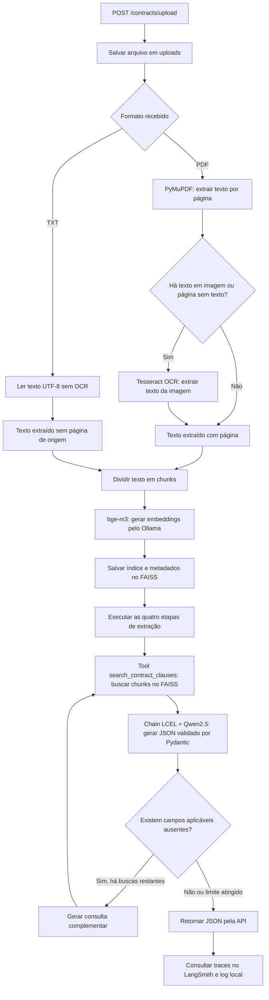

# Debenture AI

Agente de IA para extrair informações financeiras de escrituras de emissão de debêntures. Recebe contratos em **PDF ou TXT** pela API, localiza cláusulas com **RAG/FAISS**, utiliza uma LLM local pelo **Ollama** e devolve os dados em **JSON**, com referências aos trechos encontrados.

O processamento considera a **Primeira Série** e não realiza cálculos financeiros.

## 1. Pré-requisitos e tecnologias

Este projeto foi organizado para execução local no **Windows**, com:

- **Python 3.14**, versão utilizada no desenvolvimento.
- **Ollama** instalado, com os modelos `qwen2.5:7b` (extração) e `bge-m3` (embeddings).
- **Tesseract OCR** instalado, com o idioma português (`por`), para textos digitalizados em PDFs.
- Acesso à internet para instalar dependências e enviar rastreamentos ao LangSmith.

Principais dependências declaradas no projeto:

| Tecnologia | Versão especificada |
| --- | --- |
| LangChain / LangChain Core | `>=1.2,<2` |
| LangChain Ollama | `>=1.1,<2` |
| LangGraph | `>=1.0,<2` |
| LangSmith | `>=0.14.12` recomendado para Agents |
| Pydantic | `>=2.7,<3` |
| FastAPI | `==0.162.0` |
| Uvicorn | `==0.54.0` |
| PyMuPDF | `>=1.24,<2` |
| FAISS CPU | `>=1.9,<2` |
| RapidOCR | `==3.10.0` (alternativa disponível) |

As versões exatas instaladas podem ser conferidas com:

```powershell
python --version
python -m pip list
```

### Configurar o Ollama

1. Instale o Ollama em [ollama.com/download](https://ollama.com/download).
2. No PowerShell, baixe os modelos:

```powershell
ollama pull qwen2.5:7b
ollama pull bge-m3
ollama list
```

3. Confirme que a API local está disponível em `http://localhost:11434`.

No Windows, o Ollama normalmente inicia em segundo plano após a instalação. Se não estiver em execução, inicie o aplicativo Ollama ou use:

```powershell
ollama serve
```

Para verificar a API:

```powershell
Invoke-RestMethod http://localhost:11434/api/tags
```

Não é necessário executar `ollama serve` se o serviço já estiver iniciado.

### Configurar o Tesseract OCR

Para PDFs digitalizados, instale o [Tesseract OCR](https://tesseract-ocr.github.io/tessdoc/Installation.html).

Instale também o pacote de idioma português (`por`) e deixe o executável `tesseract` disponível no `PATH` do Windows.

Verifique a instalação:

```powershell
tesseract --version
tesseract --list-langs
```

## 2. Instalar as dependências Python

Abra o PowerShell na **pasta raiz do projeto**.

Crie o ambiente virtual:

```powershell
python -m venv .venv
```

Ative o ambiente virtual:

```powershell
.\.venv\Scripts\Activate.ps1
```

Instale as dependências:

```powershell
python -m pip install --upgrade pip
python -m pip install -r requirements.txt
python -m pip install --upgrade "langsmith>=0.14.12"
```

A última linha garante compatibilidade do SDK com o rastreamento para Agents do LangSmith.

Verifique se as bibliotecas foram instaladas sem conflitos antes de continuar.

## 3. Configurar o LangSmith e o arquivo `.env`

O LangSmith permite acompanhar prompts, respostas, consumo de tokens e as etapas de execução do agente.

### Criar o agente no LangSmith

1. Acesse [smith.langchain.com](https://smith.langchain.com).
2. Entre em um workspace do tipo **Agent-based**.
3. Clique em **+ Agent**.
4. Selecione **Connect > Connect an existing agent**.
5. Informe o nome `debenture-ai`.
6. Defina o **Agent ID**, por exemplo, `debenture-ai`.
7. Guarde o Agent ID, pois ele será utilizado no `.env`.

### Gerar a API Key

1. No LangSmith, acesse **Settings > API Keys**.
2. Crie uma chave com permissão para enviar traces, como uma **Tracing key**.
3. Copie a chave gerada.

### Configurar o `.env`

Na **raiz do projeto**, crie ou edite o arquivo `.env`.

Caso exista um `.env.example`, você pode utilizá-lo como referência.

```dotenv
OLLAMA_MODEL=qwen2.5:7b
OLLAMA_EMBEDDING_MODEL=bge-m3
OLLAMA_BASE_URL=http://localhost:11434
OLLAMA_CONTEXT_SIZE=16384

LANGSMITH_TRACING=true
LANGSMITH_ENDPOINT=https://api.smith.langchain.com
LANGSMITH_API_KEY=COLE_SUA_CHAVE_AQUI
LANGSMITH_AGENT_ID=debenture-ai
LANGSMITH_AGENT_ENVIRONMENT=local
```

Utilize o **Agent ID real** informado na plataforma.

Caso a API Key tenha acesso a mais de um workspace, configure também:

```dotenv
LANGSMITH_WORKSPACE_ID=SEU_WORKSPACE_ID
```

Não misture `LANGSMITH_AGENT_ID` e `LANGSMITH_AGENT_ENVIRONMENT` com `LANGSMITH_PROJECT` ou as variáveis legadas `LANGCHAIN_PROJECT` e `LANGCHAIN_SESSION`.

O projeto utiliza somente o arquivo `.env` localizado na **raiz**.

### Visualizar as execuções

Após processar um contrato:

1. Acesse o LangSmith.
2. Abra o Agent `debenture-ai`.
3. Entre em **Tracing**.
4. Selecione o ambiente **Local**.
5. Abra a execução desejada.

Será possível visualizar as chamadas da LLM, prompts, respostas, ferramentas utilizadas e informações de consumo de tokens.

O Ollama processa a LLM localmente, mas os prompts, trechos e respostas rastreados podem ser enviados ao LangSmith.

Não compartilhe o `.env` nem a API Key no repositório.

Documentação:

- [Criação de agentes](https://docs.langchain.com/langsmith/create-an-agent)
- [Chaves de API](https://docs.langchain.com/langsmith/create-account-api-key)
- [Envio de traces](https://docs.langchain.com/langsmith/log-traces-to-agent)

## 4. Executar o MVP de demonstração

O arquivo `mvp/mvp.py` demonstra o uso de prompts, chains LCEL, LLM e validação Pydantic sobre **cláusulas de exemplo já definidas no código**.

Ele não recebe arquivos PDF ou TXT. Para processar contratos completos, utilize a API descrita na próxima seção.

Na raiz do projeto, com o ambiente virtual ativado, execute:

```powershell
python -m mvp.mvp
```

Os resultados do MVP são gravados em:

- `mvp/resultado.json`: resultado da execução.
- `mvp/mvp.log`: logs da execução.

O MVP utiliza os valores padrão `qwen2.5:7b` e `http://localhost:11434`, definidos no código.

O único arquivo `.env` considerado nesta documentação fica na raiz do projeto.

Na versão examinada, o `mvp.py` não carrega automaticamente esse arquivo. Para personalizar o MVP, é necessário ajustar a leitura das configurações no código.

## 5. Executar a API e enviar um contrato

Com o Ollama iniciado e o `.env` configurado, execute na raiz do projeto:

```powershell
python -m uvicorn app.main:app --reload
```

### Endpoints

| Recurso | Endereço |
| --- | --- |
| Documentação interativa | http://127.0.0.1:8000/docs |
| Verificação de saúde | `GET /health` |
| Envio de contrato | `POST /contracts/upload` |

### Enviar um contrato

1. Acesse `http://127.0.0.1:8000/docs`.
2. Abra **POST /contracts/upload**.
3. Clique em **Try it out**.
4. Selecione o contrato no campo `file`.
5. Execute a requisição.

Também é possível utilizar o PowerShell:

```powershell
curl.exe -X POST "http://127.0.0.1:8000/contracts/upload" -F "file=@C:\caminho\contrato.pdf"
```

A API aceita arquivos **`.pdf` e `.txt` de até 25 MB**.

Cada requisição recebe um `request_id`, utilizado para identificar o arquivo, os logs, o índice FAISS e o resultado JSON.

## 6. Fluxo de execução do agente



### Etapas de extração

A extração ocorre em quatro etapas:

1. **Identificação:** emissora, CNPJ e série.
2. **Datas e valores:** datas, valor da emissão e valor nominal.
3. **Juros e correção monetária:** indexadores, taxas e metodologia de cálculo.
4. **Amortização:** condições e cronograma de amortização.

Em cada etapa, o agente recupera cláusulas pela ferramenta `search_contract_clauses` e consulta a LLM.

Caso o Pydantic identifique campos aplicáveis ausentes, o sistema poderá realizar **até três buscas complementares** na etapa e executar novamente a chain com os novos trechos recuperados.

### Diferença entre PDF e TXT

**Arquivo PDF**

- O texto é extraído por página.
- O Tesseract OCR é utilizado quando necessário.
- Os chunks preservam os números das páginas.
- Permite identificar a página de origem das informações.

**Arquivo TXT**

- O conteúdo é lido diretamente em UTF-8.
- Não utiliza OCR.
- O texto é dividido em chunks e indexado no FAISS.
- Na implementação examinada, o arquivo é tratado como um único bloco com `page_number=None`, mesmo que contenha marcadores de página escritos no texto.

Por isso, a rastreabilidade por página é mais completa no processamento de PDFs.

## 7. Organização do projeto

| Arquivo / pasta | Responsabilidade |
| --- | --- |
| `app/main.py` | Cria a aplicação FastAPI e o endpoint de saúde. |
| `app/routes/routes.py` | Recebe o arquivo e coordena o processamento. |
| `app/models/contract_response.py` | Define a estrutura da resposta da API. |
| `app/models/required_when.py` | Define condições de aplicabilidade dos campos Pydantic. |
| `app/services/file_service.py` | Valida e salva os arquivos recebidos. |
| `app/services/pdf_extraction_service_tesseract.py` | Extrai texto de PDFs e executa OCR com Tesseract. |
| `app/services/pdf_extraction_service_rapidocr.py` | Implementação alternativa de OCR com RapidOCR. |
| `app/services/txt_extraction_service.py` | Lê arquivos TXT. |
| `app/services/chunk_service.py` | Divide o texto em chunks. |
| `app/services/embedding_service.py` | Gera embeddings utilizando o `bge-m3`. |
| `app/services/vector_store_service.py` | Cria e salva o índice FAISS e seus metadados. |
| `app/services/log_service.py` | Cria e grava os logs de cada requisição. |
| `app/agents/retrieval_service.py` | Pesquisa o FAISS e disponibiliza a tool `search_contract_clauses`. |
| `app/agents/extraction_chains.py` | Executa as etapas de extração e controla buscas complementares. |
| `app/agents/llm_service.py` | Configura o Ollama e as chains LangChain. |
| `app/agents/llm_callbacks.py` | Registra prompts, chamadas da LLM, duração e tokens. |
| `app/agents/prompt_service.py` | Carrega os prompts do projeto. |
| `app/agents/prompt_formatter.py` | Monta as mensagens e o contexto da LLM. |
| `app/prompts/*.md` | Contém as regras de extração de cada etapa. |
| `mvp/mvp.py` | Executa a demonstração isolada com cláusulas de exemplo. |
| `tests/*.py` | Testes automatizados, quando presentes no projeto. |
| `requirements.txt` | Lista as dependências Python. |
| `.env` | Armazena as configurações locais e credenciais. |

## 8. Arquivos gerados e logs

Durante o processamento, a API salva os arquivos e artefatos nos seguintes diretórios, localizados na raiz do projeto:

| Caminho | Conteúdo |
| --- | --- |
| `uploads/<request_id>.pdf` ou `.txt` | Cópia do arquivo recebido pela API. |
| `logs/debenture_<data_hora_UTC>_<request_id>.log` | Log de processamento da requisição. |
| `vector_store/<request_id>/index.faiss` | Vetores indexados do contrato. |
| `vector_store/<request_id>/metadata.json` | Texto e metadados dos chunks. |
| `vector_store/<request_id>/config.json` | Configuração do índice. |
| `mvp/resultado.json` | Resultado da demonstração isolada. |
| `mvp/mvp.log` | Log da demonstração isolada. |

### Logging

O arquivo de log é criado no início de cada requisição e utiliza o `request_id` para identificação.

São registradas informações como:

- Recebimento e processamento do arquivo.
- Extração do texto e utilização de OCR.
- Geração de chunks e embeddings.
- Criação e consulta do índice FAISS.
- Prompts e respostas das chamadas da LLM.
- Quantidade de tokens utilizados.
- Duração das etapas.
- Erros de processamento.

O log é fechado ao final da requisição.

O LangSmith complementa o logging local, oferecendo acompanhamento visual das execuções do agente.

## 9. Origem dos contratos

Para desenvolver e validar a solução, são utilizadas escrituras de emissão de debêntures disponibilizadas publicamente na plataforma **ANBIMA Data**.

Acesse:

[ANBIMA Data — Busca de Debêntures](https://data.anbima.com.br/busca/debentures)

Selecione a emissão desejada e consulte os documentos disponíveis, respeitando as condições de acesso e uso da plataforma.